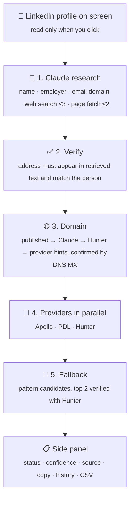

<div align="center">

# 🔎 Prospect Finder

**Open a LinkedIn profile → click _Find contact_ → get a work email and phone number.**

An Apollo-style Chrome extension with confidence scores, sources and the cost of every lookup.

<p>
  
  
  
  
  
</p>

[Features](#-features) · [How it works](#-how-a-lookup-works) · [Install](#-install) · [CLI](#-cli--claude-code-skill) · [Projects](#-whats-in-this-repo) · [Responsible use](#%EF%B8%8F-responsible-use)

</div>

---

## ✨ Features

| | |
|---|---|
| 🧠 **Claude research** | One request parses the profile and searches the public web for the person's published email |
| ✅ **Verified, not guessed** | An address counts as "published" only if it really appears in the retrieved page text |
| 🔌 **Data providers** | Optional Apollo, People Data Labs and Hunter lookups, run in parallel |
| 🧮 **Smart fallback** | Pattern candidates ranked by formats seen in real colleague addresses |
| 💸 **Cost transparency** | Tokens, searches and $ shown on every result and in the CSV export |
| 🖥️ **Three ways to run** | Chrome side panel, terminal CLI, or the `/find-contact` Claude Code skill |

---

## ⚙️ How a lookup works



<details>
<summary><b>Step-by-step details</b></summary>

1. **Claude research**: one request, billed to your Anthropic key. It returns a clean name, the current employer and the company's real email domain. Web search and page fetches stream live to the panel. LinkedIn and data-broker sites are blocked.
2. **Verify**: an address is credited to the person only if it fits their name or their name is beside it on the page. Namesakes and team inboxes like `careers@` are labelled, not mistaken for them. Colleagues' verified addresses vote on the company format: agreement raises confidence, a split lowers it. If nothing is verified, **Search deeper** runs a broader pass and keeps everything the quick pass found.
3. **Domain**: each candidate domain is confirmed by DNS MX.
4. **Providers**: each one is optional.
   - **Apollo** `people/match` → verified work email, personal emails\*, company phone
   - **PDL** `person/enrich` → work email, mobile and phone numbers
   - **Hunter** `email-finder` → email with a deliverability score
5. **Fallback**: if there's no published or verified work email, it builds pattern candidates (formats seen in real published addresses first, then Hunter's pattern, then Claude's ranking) and verifies the top 2 with Hunter.

\* only when you turn on "Ask Apollo for personal emails".

</details>

---

## 🚀 Install

1. Open `chrome://extensions`, turn on **Developer mode**, click **Load unpacked**, and choose this folder.
2. Open the extension's **Settings** (right-click the icon → Options) and add:
   - 🔑 **An Anthropic API key** (default model `claude-opus-5-5`; `claude-sonnet-5-5` costs about half)
   - 🔌 **Optional provider keys:** Apollo, People Data Labs and/or Hunter (needed for phone numbers and deliverability checks)
3. Open any `linkedin.com/in/...` profile (Recruiter and Sales Navigator pages work too) and click **Find contact**.

---

## 📊 What to expect

| Keys configured | 📧 Work email | 📞 Phone |
|---|---|---|
| Claude only | The person's address when it's published anywhere public (with a source link); otherwise the company format or ranked guesses | None |
| Claude + Hunter | Verified email for most people at companies with their own domain | Rarely |
| Claude + Apollo | Verified email for most B2B profiles | Company switchboard; mobile numbers need Apollo's webhook flow (not built in) |
| Claude + PDL (paid) | Good | Best coverage of mobile numbers |
| **All three** | **Highest coverage**; agreement between sources raises confidence | **Best available** |

**Statuses:**
🟢 **published**: found verbatim on a public page, source linked ·
🔵 **valid/verified**: checked by a provider ·
🟡 **unconfirmed**: Claude reported it but it wasn't in the retrieved text ·
⚪ **guess**: pattern only

> No tool finds 100% of contacts.

---

## 💰 Cost per lookup

- **Claude:** one low-effort request with up to 3 web searches ($0.01 each) and 2 page fetches. Most input tokens are search results and fetched pages. `claude-sonnet-5-5` roughly halves the token cost.
- **Providers:** at most 1 Apollo call, 1 PDL call and 2–4 Hunter calls per lookup. Turn off verification in Settings to save Hunter credits.

---

## 🖥️ CLI & Claude Code skill

```bash
export HUNTER_API_KEY=... APOLLO_API_KEY=... PDL_API_KEY=...

# Structured input, no LLM call
node cli/find-contact.mjs --name "Jane Doe" --company "Acme Corp" --linkedin https://www.linkedin.com/in/janedoe

# Raw profile text, one LLM call
ANTHROPIC_API_KEY=... node cli/find-contact.mjs --profile-file profile.txt --json
```

In Claude Code, from this folder, run:

```
/find-contact Jane Doe, recruiter at Acme
```

Claude parses the input itself, using the session's tokens, and runs the CLI.

---

## 📦 What's in this repo

| Project | Description |
|---|---|
| **Prospect Finder** (root) | The Claude-powered Chrome extension, CLI and skill described above |
| [`zero-cost-extension/`](zero-cost-extension/) | 🆓 A Chrome extension with no AI and no API keys. It finds publicly published emails using local TypeScript algorithms only |
| [`platform/`](platform/) | 🐳 A self-hosted web app (FastAPI + React, Docker Compose) for contact discovery with the evidence behind each result |

<details>
<summary><b>📁 Project layout (root extension)</b></summary>

```
manifest.json
src/background.js         service worker: runs lookups, stores history
src/content.js/.css       "Find contact" button; reads the profile on screen
src/settings.js           chrome.storage settings
src/core/                 environment-neutral pipeline (extension and Node)
  llm.js                  Claude request: profile parsing + public web research
  providers.js            Apollo, PDL, Hunter clients
  email.js                pattern generation, DNS-over-HTTPS MX lookup
  pipeline.js             orchestration, merging, confidence
  pricing.js              token → USD
src/ui/                   side panel and options page
cli/find-contact.mjs      terminal entry point
.claude/skills/find-contact/SKILL.md
test/                     node --test (mocked HTTP)
```

</details>

```bash
npm test       # run the test suite
npm run zip    # package the extension
```

---

## ⚖️ Responsible use

- 👁️ The extension reads only the profile you're looking at, and only when you click. It doesn't crawl LinkedIn or send it any requests. Automated scraping breaks LinkedIn's User Agreement and gets accounts restricted.
- 📜 Contact data comes from licensed providers under their terms. Outreach is still subject to GDPR, CAN-SPAM, TCPA (no automated calls or texts to mobile numbers without consent) and similar laws where you operate.
- 🔐 API keys stay in `chrome.storage.local` on your machine and are sent only to the service they belong to.

<div align="center">

---

Made with ☕ by [Ayush Kumar](https://github.com/Ayush-Kmr)

</div>
